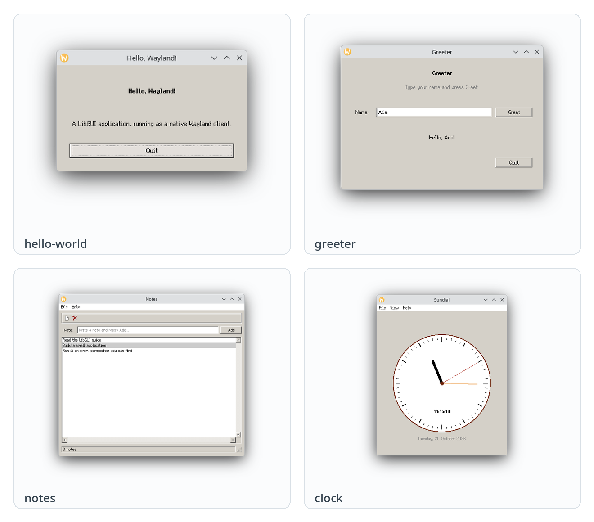
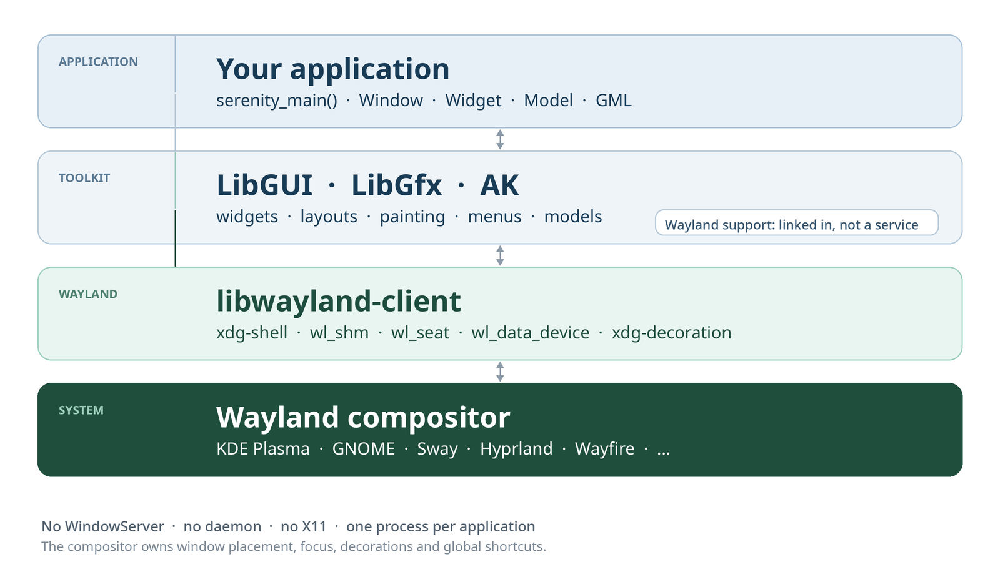
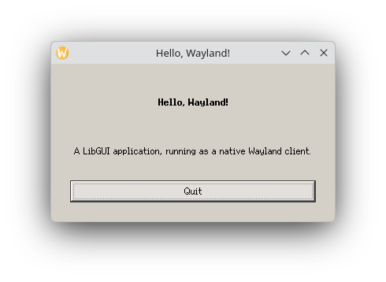
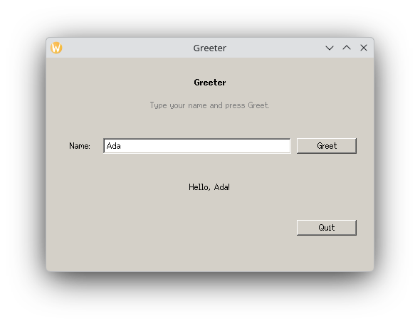
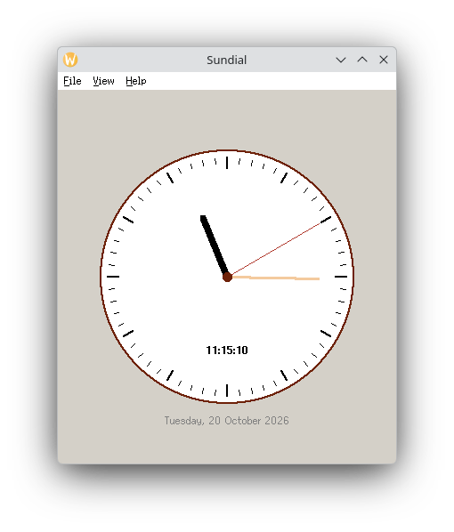
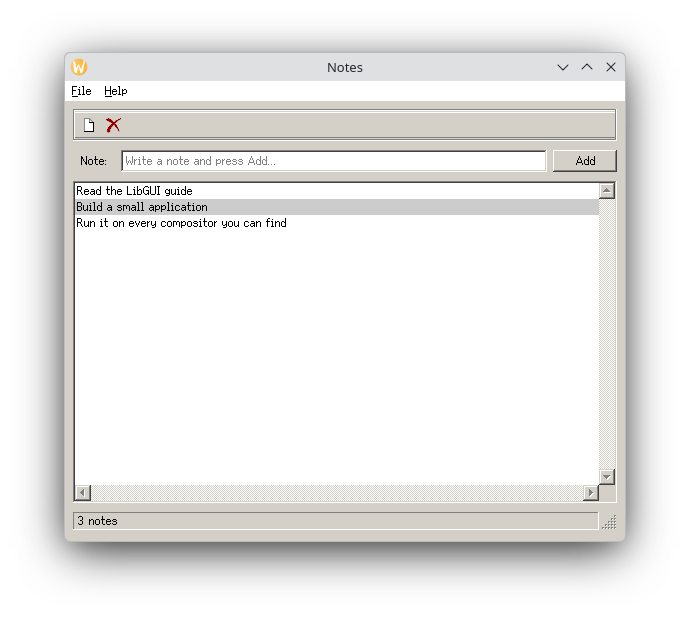

# About this guide

This is a practical introduction to writing desktop applications with **LibGUI**, the widget toolkit that began life inside SerenityOS, and running them as native Wayland clients on Linux with **libgui-wayland**.

You do not need to know anything about Wayland protocols, compositor internals, or SerenityOS itself. You need to be comfortable with modern C++: classes, templates, ownership, and callbacks. By the end you will have built four small but complete applications, and you will understand the conventions that make a LibGUI program feel at home in the SerenityOS codebase.

The guide is organised in three parts:

- **Foundations** (chapters 1 and 2) explain what the stack is, how the pieces fit together, and how to build it.
- **The toolkit** (chapters 3 to 6) builds the examples: a hello-world window, an interactive greeter, a custom-painted clock, and a GML-based notes application with a model and a list view.
- **Practice** (chapters 7 to 10, plus the appendices) covers the SerenityOS coding style, portable Wayland behaviour, packaging, debugging, and where to go next.

Every example is in the `examples/` directory of the repository. The complete source is more useful than a screenshot, so the code in the chapters is deliberately close to the files you can build and run.

> **A note on origins.** LibGUI, LibGfx, and AK come from SerenityOS, a from-scratch desktop operating system. This guide uses those libraries as portable C++ libraries on Linux. It does not require SerenityOS, the SerenityOS kernel, or the separate Serenity Desktop Environment. SerenityOS is mentioned only to explain where the APIs and conventions came from.

## Who this is for

This guide is for you if:

- you have written C++ before and are comfortable reading a class declaration;
- you want a native Linux GUI without learning a new protocol stack first;
- you like the idea of a small, explicit toolkit with its own string, container, and error-handling types;
- you want your application to run on KDE Plasma, GNOME, Sway, Hyprland, Wayfire, or any other Wayland compositor.

It is not a reference manual. The appendices point to the parts of the API you will use most, and the source tree is the final authority.

## How the code is presented

Code is shown in monospaced boxes with the file name in the header. Ellipses are not used inside compilable examples; when a listing is an excerpt, the surrounding prose says so. Paths are relative to the repository root unless stated otherwise.

The examples were built with the pinned SerenityOS revision fetched by `scripts/fetch-serenity.sh` and the host build produced by `scripts/build-libgui.sh`. The screenshots were taken on a KDE Plasma Wayland session; your compositor will draw different window decorations.

## Conventions

| Convention | Meaning |
|---|---|
| `build/lagom` | The Lagom host build directory produced by the build script |
| `serenity/` | The pinned SerenityOS source checkout |
| `SERENITY_RES_ROOT` | Directory containing SerenityOS's `Base/res` tree (fonts, themes, icons) |
| `app_id` | The Wayland application identifier; the toolkit uses the executable's base name |

## What you will build

The guide builds four applications, each introducing one layer of the toolkit: a minimal window, an interactive form, a custom-painted clock, and a GML-based notes application with a model and a list view. They are small enough to read in one sitting and complete enough to run on a real desktop.

{width=105mm}

<!-- toc -->

# 1. The stack in one page

LibGUI is a complete desktop widget toolkit. LibGfx is the drawing library underneath it, and AK is the standard-library replacement that supplies strings, vectors, hash maps, smart pointers, and error handling. All three began life inside SerenityOS, a from-scratch desktop operating system, and they are now portable C++ libraries that run on Linux.

This guide is about the application side of the stack: windows, widgets, layouts, painting, models, menus, and the conventions that keep a LibGUI program readable. On Wayland, **the compositor is the display server**. There is no WindowServer service in the session, and your application is an ordinary Wayland client. The toolkit's Wayland support is linked into the application process; you do not program against it, start it, or configure it per desktop.

The SerenityOS heritage explains a few API names and a handful of internal interfaces, but it is not the model you program against here. You create a `GUI::Window`, add widgets, and call `exec()`. Your code never talks to a display-server service, never sends display-server IPC messages itself, and never needs a SerenityOS service to be running.

## 1.1 Where the pieces come from

| Piece | What it is | Where it came from |
|---|---|---|
| **AK** | Strings, containers, smart pointers, `ErrorOr`, formatting | SerenityOS userland |
| **LibGfx** | Bitmaps, colours, fonts, paths, 2D painting | SerenityOS userland |
| **LibGUI** | Application, windows, widgets, layouts, menus, models, views | SerenityOS userland |
| **LibMain** | The entry point that calls `serenity_main` | SerenityOS userland |
| **Wayland support** | Presents LibGUI windows as Wayland surfaces and maps input back to widgets | This project; linked into your process |

The applications in the SerenityOS tree — Calculator, TextEditor, PixelPaint, PDFViewer, and many others — are ordinary clients of these libraries. Some of them run on Linux through this stack without source changes.

## 1.2 How a window reaches the screen

The path from your code to the display is deliberately short:

1. You create a `GUI::Window` and a tree of widgets, and LibGUI paints them into a `Gfx::Bitmap` that backs the window.
2. The toolkit's Wayland support presents that bitmap as a `wl_surface` with an `xdg_toplevel`. The pixels travel through a shared-memory `wl_shm` buffer.
3. The compositor places the window, draws its decorations (or asks the toolkit to draw them), composites it with the rest of the desktop, and sends input events.
4. The Wayland support turns pointer and keyboard events into the LibGUI events that your widgets already handle.
5. Menus become `xdg_popup` surfaces; clipboard data travels over `wl_data_device`; file dialogs go through the standard desktop portal when one is available.



The support layer is an implementation detail. You do not call it directly, you do not configure it per compositor, and you do not write Wayland protocol code. It is linked into your executable because that is how the toolkit receives Wayland events in-process; there is no daemon and no extra process between your application and the compositor. The build names the support library `libwindowserver.so` for historical reasons; despite the name, it is an in-process library, not a service.

Because each application is its own Wayland client, it gets the compositor's normal treatment: focus, stacking, tiling, window switching, and decorations are handled where they belong. The application does not need a global window list, a taskbar, or a workspace manager to be part of its process.

## 1.3 What you get, and what you do not

You get a complete desktop widget toolkit: labels, buttons, text boxes, check boxes, combo boxes, sliders, list and table views, tabs, splitters, menus, toolbars, status bars, dialogs, file pickers, a clipboard, a 2D painter, fonts, images, and a model/view architecture.

You also get the compositor's normal behaviour: focus, stacking, window switching, tiling, shortcuts, and decorations are owned by the compositor, not by your application. That is the correct Wayland model, and it is why the application works on desktops with very different window-management policies.

There are things you should **not** expect:

- **Absolute window placement.** `xdg-shell` has no way to say "put this window at (100, 200)". `Window::set_rect()` carries a position for LibGUI's own bookkeeping, but the compositor decides where a toplevel appears. Use `resize()` for size and let the compositor place the window.
- **Global shortcuts.** Your `GUI::Action` shortcuts work while your window has focus. Grabbing a key globally is a compositor or portal feature, not an application feature.
- **A taskbar, applet host, or window switcher.** Those are desktop-environment components. This stack does not provide them, and this guide does not use them.
- **Screen capture or pointer warping.** Those are controlled by the compositor and its portals.
- **The host desktop's widget theme.** LibGUI applications use SerenityOS's theme and fonts from the resource tree. Your compositor still draws the window frame in its own style, as the screenshots show.
- **A WindowServer service.** There is no such service in a Wayland session, and your application must not assume one exists.

## 1.4 A note on the Serenity Desktop Environment

The Serenity Desktop Environment (SDE) is a separate project that builds a Serenity-shaped session on Linux: a taskbar, applets, a WindowServer service, an AudioServer, and other system services. It is useful if you want to reproduce the full SerenityOS desktop, but **nothing in this guide depends on it**.

In particular, do not build an application around:

- the WindowServer service or its IPC endpoints;
- the Taskbar or its window-list protocol;
- layer-shell panels or desktops;
- AudioServer or AudioManager IPC;
- NotificationServer internals;
- WindowManager-specific window states or global mouse tracking;
- absolute window coordinates or workspace numbers.

Use `GUI::Application`, `GUI::Window`, widgets, models, `Gfx::Painter`, actions, menus, the clipboard, and the file picker. Those are the portable surface, and they are enough for a real application. If an API only exists to talk to a SerenityOS system service, it is not part of this guide's programming model.

# 2. Getting the stack running

This chapter gets you from a fresh checkout to a running window. The first build is long because it compiles a large part of the SerenityOS userland, including LibGUI, LibGfx, LibWeb, and a set of applications. Later builds are incremental.

## 2.1 Requirements

You need:

- a 64-bit Linux system with a Wayland session (KDE Plasma, GNOME, Sway, Hyprland, Wayfire, and similar all work);
- a C++ compiler with C++26 support (the build uses `-std=c++26`; GCC 14 or newer, or a recent Clang);
- CMake, Ninja, `pkg-config`, and Python 3;
- Wayland client development files, `xkbcommon`, and `wayland-protocols`;
- the usual font and image libraries used by LibGfx.

On Debian or Ubuntu, the development packages are typically:

```bash
sudo apt install build-essential cmake ninja-build pkg-config python3 \
    libwayland-dev libxkbcommon-dev wayland-protocols \
    libegl-dev libgl1-mesa-dev libpulse-dev
```

On Fedora:

```bash
sudo dnf install gcc-c++ cmake ninja-build pkgconf-pkg-config python3 \
    wayland-devel libxkbcommon-devel wayland-protocols-devel \
    mesa-libEGL-devel mesa-libGL-devel pulseaudio-libs-devel
```

Package names vary. If CMake reports a missing `wayland-client` or `xkbcommon`, install the corresponding development package and re-run the build.

## 2.2 Build the framework

From the repository root:

```bash
git clone https://github.com/your-org/libgui-wayland.git
cd libgui-wayland

scripts/fetch-serenity.sh      # pinned, blobless, sparse SerenityOS checkout
scripts/build-libgui.sh        # patches + LibGfx/LibGUI + Wayland support + tests
```

`fetch-serenity.sh` downloads the pinned SerenityOS revision into `serenity/`. It is a sparse checkout, so it does not pull the kernel or the full toolchain. `build-libgui.sh` applies the small host-build patches in `patches/`, configures Lagom (SerenityOS's host build), and builds the libraries, the Wayland support library, the test applications, and the integration tests.

When it finishes, the important paths are:

```text
build/lagom/lib/liblagom-gui.so       LibGUI
build/lagom/lib/liblagom-gfx.so       LibGfx
build/lagom/lib/liblagom-ak.so        AK
build/lagom/lib/libwindowserver.so    Wayland support (in-process; name is historical)
build/lagom/bin/Calculator            an unmodified SerenityOS application
build/lagom/bin/GMLCompiler           the GML-to-C++ compiler
```

You can smoke-test the stack with the unmodified Calculator:

```bash
export SERENITY_RES_ROOT="$PWD/serenity/Base/res"
build/lagom/bin/Calculator
```

The binary has an rpath that points at `build/lagom/lib`, so it runs from the build tree without `LD_LIBRARY_PATH`. `SERENITY_RES_ROOT` tells the toolkit where the SerenityOS themes, fonts, and icons live. If you move the build tree, set it to the matching `Base/res` directory.

> **Tip:** If you only want to rebuild the framework after changing the Wayland support library, `scripts/build-libgui.sh --no-tests` skips the upstream and integration test suites. Use the full build when you want to verify the whole stack.

## 2.3 Build and run the examples

The guide's examples live in `examples/` and have their own small Makefile:

```bash
cd examples
make
./bin/hello-world
```

You should see a window like the one in the next chapter. The Makefile builds four binaries into `examples/bin`:

| Binary | What it demonstrates |
|---|---|
| `hello-world` | Application, window, layout, label, button |
| `greeter` | Nested layouts, text input, callbacks, focus |
| `notes` | GML, a custom model, list view, actions, menus, toolbar |
| `clock` | A custom widget, `Gfx::Painter`, a timer, palettes |

The examples use the build tree at `build/lagom`. If yours is elsewhere:

```bash
make LAGOM=/path/to/build/lagom SERENITY=/path/to/serenity
```

To run an example from outside the repository, keep `SERENITY_RES_ROOT` pointing at the resource tree:

```bash
SERENITY_RES_ROOT="$PWD/serenity/Base/res" examples/bin/notes
```

## 2.4 What the Makefile does

The Makefile is deliberately small so you can see the whole build. The essential flags are:

```makefile title="examples/Makefile"
CPPFLAGS += \
    -I$(SERENITY) \
    -I$(SERENITY)/Userland \
    -I$(SERENITY)/Userland/Libraries \
    -I$(SERENITY)/Userland/Services \
    -I$(LAGOM) \
    -I$(LAGOM)/Userland/Libraries \
    -I$(LAGOM)/Userland/Services \
    -I$(CURDIR)/../compat

LDFLAGS += -L$(LAGOM)/lib -Wl,--no-as-needed -Wl,-rpath,$(LAGOM)/lib
LDLIBS += -llagom-gui -llagom-gfx -llagom-core -llagom-corebasic \
          -llagom-ipc -llagom-main -llagom-ak -lwindowserver
```

Three details matter:

1. **The include paths cover both the source tree and the build tree.** Some headers are generated during the Lagom build (for example, GML output and IPC endpoint definitions), so `-I$(LAGOM)/Userland/Libraries` is not optional.
2. **`-Wl,--no-as-needed` keeps the Wayland support library loaded.** The library installs the toolkit's platform hooks from a static initialiser. Without `--no-as-needed`, the linker may drop `libwindowserver.so` because no symbol in your object files refers to it directly, and the application would then fail during startup. The library's name is historical; it is linked into the process and there is no WindowServer service behind it.
3. **The rpath makes the examples runnable from the build tree.** For an installed application, use an install rpath such as `$ORIGIN/../lib`, or install the libraries in the system library directory.

The examples link only what they need. A larger application may add `-llagom-desktop`, `-llagom-config`, `-llagom-filesystemaccessclient`, or `-llagom-audio` depending on which libraries it uses.

> **Note:** The examples are single-file programs. That keeps the build simple and makes the listings easy to follow. Real applications normally split widgets and windows into headers and `.cpp` files, exactly as the SerenityOS applications do.

## 2.5 The shape of a project

A small LibGUI application usually looks like this:

```text
notes/
├── CMakeLists.txt or Makefile
├── main.cpp              serenity_main(), application setup, menus
├── NotesWindow.gml       optional declarative UI
├── NotesWidget.cpp       custom widgets and event handlers
├── NotesWidget.h
└── NotesModel.cpp        optional model for list/table views
```

`main.cpp` should stay small: create the application, create the main window, connect the actions, show the window, and enter the event loop. Widgets own their children, so you rarely need to store more than the objects you will update later.

You can also add an application to the SerenityOS tree under `Userland/Applications/<Name>` and build it through Lagom. That is the right choice if you are contributing an application upstream or need the full SerenityOS application conventions. This guide uses an out-of-tree Makefile so the examples stay self-contained.

## 2.6 Troubleshooting

| Symptom | Likely cause | Fix |
|---|---|---|
| `error: wayland-client not found` | Missing Wayland development package | Install `libwayland-dev` or the distro equivalent, then reconfigure |
| `cannot open shared object file: liblagom-gui.so` | Library path is wrong | Run from the build tree, set `LD_LIBRARY_PATH`, or fix the rpath |
| Window appears but text and icons are missing | `SERENITY_RES_ROOT` is not set or points at the wrong tree | Point it at `serenity/Base/res` |
| Application exits immediately with a startup error | The Wayland support library was dropped by the linker | Add `-Wl,--no-as-needed` before `-lwindowserver` |
| `Failed to connect to Wayland display` | No Wayland session, or `WAYLAND_DISPLAY` is unset | Run inside a Wayland session; check `echo $WAYLAND_DISPLAY` |
| Window is placed somewhere unexpected | Wayland does not support absolute placement | Use `resize()` and let the compositor place it |
| Menus do not appear | The compositor rejected the popup, or a grab is active | Check the application log; test on a second compositor |
| Text looks soft on a HiDPI screen | The toolkit currently presents logical-size buffers | See the HiDPI note in chapter 5 |

# 3. Your first application

The first example is deliberately minimal: a window, a heading, a line of text, and a button that quits. It is enough to see the whole lifecycle of a LibGUI program.

## 3.1 The complete program

```cpp title="examples/hello-world/main.cpp"
#include <LibGUI/Application.h>
#include <LibGUI/BoxLayout.h>
#include <LibGUI/Button.h>
#include <LibGUI/Label.h>
#include <LibGUI/Widget.h>
#include <LibGUI/Window.h>
#include <LibMain/Main.h>

ErrorOr<int> serenity_main(Main::Arguments arguments)
{
    auto app = TRY(GUI::Application::create(arguments));

    auto window = GUI::Window::construct();
    window->set_title(ByteString { "Hello, Wayland!" });
    window->resize(360, 200);

    auto main_widget = window->set_main_widget<GUI::Widget>();
    main_widget->set_fill_with_background_color(true);
    main_widget->set_layout<GUI::VerticalBoxLayout>(GUI::Margins { 24 }, 12);

    auto& label = main_widget->add<GUI::Label>("Hello, Wayland!"_string);
    label.set_font_size(20);
    label.set_font_weight(700);
    label.set_text_alignment(Gfx::TextAlignment::Center);

    auto& hint = main_widget->add<GUI::Label>("A LibGUI application, running as a native Wayland client."_string);
    hint.set_text_alignment(Gfx::TextAlignment::Center);

    main_widget->add_spacer();

    auto& quit_button = main_widget->add<GUI::Button>("Quit"_string);
    quit_button.set_fixed_height(28);
    quit_button.on_click = [&](unsigned) {
        app->quit(0);
    };

    window->show();
    return app->exec();
}
```

## 3.2 Walking through it

### The entry point

LibGUI applications use `serenity_main`, not `main`. `LibMain` provides the platform entry point and calls `serenity_main` with parsed arguments, then turns the returned `ErrorOr<int>` into a process exit status. This is a SerenityOS convention that LibMain preserves on Linux.

`serenity_main` returns `ErrorOr<int>` because almost everything that can fail — creating the application, loading a resource, opening a file — is expressed as an `ErrorOr`. Inside the function, `TRY` unwraps a successful value or returns the error to the caller.

### The application object

```cpp
auto app = TRY(GUI::Application::create(arguments));
```

`Application` owns the event loop, the connection to the display, the active theme, and application-wide state such as the global action table. `create` returns a non-null reference-counted pointer. There is exactly one `Application` per process, and `Application::the()` gives you the current one.

Creating the application also initialises the toolkit's Wayland support, which is linked into the process. There is no separate setup call in a normal application, and no service to start.

### The window

```cpp
auto window = GUI::Window::construct();
window->set_title(ByteString { "Hello, Wayland!" });
window->resize(360, 200);
```

A `Window` is a toplevel. On Wayland it becomes an `xdg_toplevel`, and the compositor decides where it goes. The size is in **logical pixels**, not physical pixels; the toolkit and the compositor handle the output scale.

The title is a `ByteString`, while most user-facing text in widgets is a `String`. That distinction comes from SerenityOS: `String` is UTF-8 text, `ByteString` is raw bytes and is used for identifiers, paths, and protocol strings. When a function takes a `ByteString`, `ByteString { "..." }` is the clearest way to pass a literal. Chapter 7 covers the string types in detail.

### The main widget

```cpp
auto main_widget = window->set_main_widget<GUI::Widget>();
main_widget->set_fill_with_background_color(true);
main_widget->set_layout<GUI::VerticalBoxLayout>(GUI::Margins { 24 }, 12);
```

Every window has exactly one **main widget**, which fills the window's content area. All other widgets are descendants of the main widget. `set_main_widget<T>()` constructs the widget, installs it, and returns a non-null reference-counted pointer to it.

`set_fill_with_background_color(true)` makes the widget paint the theme's window colour before its children. Without it, parts of the window that no child paints will show through as black or transparent depending on the surface format. Most container widgets set this.

The layout is a `VerticalBoxLayout` with 24 pixels of margin on every side and 12 pixels between children. Layouts are owned by the widget and run whenever the widget is resized or a child's size requirements change. You rarely position widgets by hand.

### Children

```cpp
auto& label = main_widget->add<GUI::Label>("Hello, Wayland!"_string);
```

`add<T>()` constructs a child, adds it to the widget, and returns a reference. The parent owns the child for its lifetime; you do not delete it. The reference remains valid as long as the parent exists and the child is not removed.

Labels accept a `String`, which is why the literal is written `"Hello, Wayland!"_string`. The `_string` suffix is an AK user-defined literal. Another common suffix is `sv` for `StringView`. A `ByteString` is usually constructed with `ByteString { "..." }`.

`set_font_size` takes a point size and `set_font_weight` takes a numeric weight. `700` is bold. The theme's font family stays the same.

### The button and the event loop

```cpp
quit_button.on_click = [&](unsigned) {
    app->quit(0);
};
```

`on_click` is an `AK::Function<void(unsigned)>`. The argument is the keyboard modifier mask at the time of the click; this example ignores it. The lambda captures `app` by reference. That is safe because `app` lives in `serenity_main`, which is still on the stack while the event loop runs.

`window->show()` maps the window and asks the compositor for a surface. `app->exec()` runs the event loop until `quit` is called or the last window is closed.



## 3.3 Build and run

From the `examples` directory:

```bash
make bin/hello-world
./bin/hello-world
```

Or, if you are running from elsewhere:

```bash
SERENITY_RES_ROOT="$PWD/serenity/Base/res" examples/bin/hello-world
```

If the window is empty, the usual causes are a missing resource root (no fonts or theme) or a missing `--no-as-needed` when linking (the Wayland support library was not loaded). The troubleshooting table in chapter 2 covers both.

## 3.4 What happens when you click Quit

The click travels through several layers, and the path is worth understanding because it is the same path every widget event takes:

1. The compositor sends a `wl_pointer.button` event to the application's `wl_seat`.
2. The toolkit's Wayland support translates it into a LibGUI mouse event and dispatches it to the window.
3. LibGUI's window dispatches the event to the widget under the pointer.
4. `Button` updates its pressed state, paints the new state, and invokes `on_click` on release.
5. Your lambda calls `Application::quit(0)`.
6. The event loop returns from `exec`, `serenity_main` returns `0`, and the process exits.

Nothing in that path is specific to KDE or GNOME. The only compositor-specific part is the window decoration and the placement policy.

## 3.5 Exercises

1. Change the window title and the label text. Rebuild and confirm that the title bar updates.
2. Add a second button that changes the label to `"Pressed!"_string` instead of quitting.
3. Replace the spacer with a horizontal row containing two buttons, one of which quits and one of which prints a message with `dbgln`.
4. Set a close-request handler with `window->on_close_request` that prints a message and returns `GUI::Window::CloseRequestDecision::Close`.

# 4. Widgets, layouts and events

A GUI application is a tree of widgets plus a loop that turns input into callbacks. This chapter builds the second example, a greeter, and uses it to explain both halves.

## 4.1 The widget tree

The window owns its main widget; every container widget owns its children. A typical tree for the greeter looks like this:

```text
Window
└── main Widget                 vertical layout
    ├── Label ("Greeter")
    ├── Label ("Type your name...")
    ├── Widget                  horizontal layout
    │   ├── Label ("Name:")
    │   ├── TextBox
    │   └── Button ("Greet")
    ├── Label (greeting)
    ├── Spacer
    └── Widget                  horizontal layout
        ├── Spacer
        └── Button ("Quit")
```

Ownership follows the tree. A widget is destroyed when its parent is destroyed, and removing a child from its parent destroys it unless something else holds a reference. This is why `add<T>()` returns a reference rather than an owning pointer: the parent is the owner.

You can find a descendant by name when the widget was created from GML or given a name in code:

```cpp
auto* input = main_widget->find_descendant_of_type_named<GUI::TextBox>("note_input");
```

The returned pointer is **borrowed**. Do not store it beyond the lifetime of the tree. If you need to keep a widget alive independently, hold a `NonnullRefPtr` or `RefPtr` to it; chapter 7 explains when that is appropriate.

## 4.2 Layouts

LibGUI has two box layouts and a handful of specialised containers. The box layouts are enough for most interfaces.

| Layout | Direction | Typical use |
|---|---|---|
| `GUI::VerticalBoxLayout` | top to bottom | Forms, sidebars, page stacks |
| `GUI::HorizontalBoxLayout` | left to right | Toolbars, rows of buttons, label/field pairs |
| `GUI::StackWidget` | one visible child | Pages, wizards |
| `GUI::TabWidget` | tabbed pages | Settings, document tabs |
| `GUI::Splitter` | resizable panes | Editors with a sidebar |
<!-- widths: 28,16,56 -->

A layout has `margins` and `spacing`. Margins are ordered top, right, bottom, left when four values are given, or all sides when one value is given:

```cpp
main_widget->set_layout<GUI::VerticalBoxLayout>(GUI::Margins { 24 }, 10);
```

Each child can express size requirements:

| Property | Meaning |
|---|---|
| `fixed_width` / `fixed_height` | Exactly this size; sets both min and max |
| `min_width` / `max_width` | Bounds for the layout algorithm |
| `preferred_width` / `preferred_height` | The size the widget would like |
| `"shrink"` | Take only what the content needs |
| `"grow"` | Take a share of the remaining space |
| `"fit"` | Fit the content, growing if possible |
| `"opportunistic_grow"` | Grow only if there is spare room |

In code, the same ideas are expressed with `set_fixed_width`, `set_min_width`, `set_max_width`, `set_preferred_width`, and the `GUI::SpecialDimension` values. In GML they are strings such as `"shrink"` or `"grow"`.

`add_spacer()` adds an invisible, expanding entry. It is the simplest way to push a group of widgets to one edge:

```cpp
main_widget->add_spacer();       // everything after this is pushed down
```

## 4.3 The greeter

The greeter adds text input, nested layouts, and a callback that reads state from a widget.

```cpp title="examples/greeter/main.cpp"
ErrorOr<int> serenity_main(Main::Arguments arguments)
{
    auto app = TRY(GUI::Application::create(arguments));

    auto window = GUI::Window::construct();
    window->set_title(ByteString { "Greeter" });
    window->resize(460, 300);

    auto main_widget = window->set_main_widget<GUI::Widget>();
    main_widget->set_min_size(380, 260);
    main_widget->set_fill_with_background_color(true);
    main_widget->set_layout<GUI::VerticalBoxLayout>(GUI::Margins { 24 }, 10);

    auto& title = main_widget->add<GUI::Label>("Greeter"_string);
    title.set_font_size(24);
    title.set_font_weight(700);
    title.set_text_alignment(Gfx::TextAlignment::Center);

    auto& subtitle = main_widget->add<GUI::Label>("Type your name and press Greet."_string);
    subtitle.set_text_alignment(Gfx::TextAlignment::Center);
    subtitle.set_foreground_role(Gfx::ColorRole::DisabledText);

    auto& name_row = main_widget->add<GUI::Widget>();
    name_row.set_layout<GUI::HorizontalBoxLayout>(GUI::Margins {}, 8);

    auto& name_label = name_row.add<GUI::Label>("Name:"_string);
    name_label.set_fixed_width(48);

    auto& name_input = name_row.add<GUI::TextBox>();
    name_input.set_text("Ada"_string);

    auto& greet_button = name_row.add<GUI::Button>("Greet"_string);
    greet_button.set_fixed_width(84);

    auto& greeting = main_widget->add<GUI::Label>("Hello, Ada!"_string);
    greeting.set_font_size(20);
    greeting.set_text_alignment(Gfx::TextAlignment::Center);

    main_widget->add_spacer();

    auto& footer = main_widget->add<GUI::Widget>();
    footer.set_layout<GUI::HorizontalBoxLayout>(GUI::Margins {}, 8);
    footer.add_spacer();

    auto& quit_button = footer.add<GUI::Button>("Quit"_string);
    quit_button.set_fixed_width(84);

    auto greet = [&] {
        auto name = name_input.text();
        if (name.is_empty())
            greeting.set_text("Hello, stranger!"_string);
        else
            greeting.set_text(MUST(String::formatted("Hello, {}!", name)));
    };

    greet_button.on_click = [&](unsigned) {
        greet();
    };

    name_input.on_return_pressed = [&] {
        greet();
    };

    quit_button.on_click = [&](unsigned) {
        app->quit(0);
    };

    window->show();
    name_input.set_focus(true);
    return app->exec();
}
```

There are a few details worth calling out:

- The window's minimum size is set on the **main widget**, not on the window. A `Window` obeys its main widget's minimum size by default, and calling `Window::set_minimum_size` while that is true triggers a verification failure. If you want to set the window minimum directly, call `window->set_obey_widget_min_size(false)` first.
- `name_input.text()` returns a `ByteString`, because text editors deal in bytes. `String::formatted` accepts it and produces a `String`. `MUST` here asserts that formatting cannot fail except for allocation failure; chapter 7 explains when that is acceptable.
- The `greet` lambda captures the widgets by reference. All of them live in the window, which lives until `serenity_main` returns, so the captures stay valid.
- `on_return_pressed` is separate from `on_change`. Use `on_change` for live validation and `on_return_pressed` for committing a value.



## 4.4 Events

Widgets override virtual event handlers or expose callback functions. The most useful ones are:

| Event | Where it comes from | Typical use |
|---|---|---|
| `paint_event(PaintEvent&)` | Window invalidation or `update()` | Custom drawing |
| `resize_event(ResizeEvent&)` | Layout or window resize | Recompute geometry |
| `mousedown_event` / `mouseup_event` | Pointer buttons | Direct manipulation |
| `mousemove_event` | Pointer motion | Hover, drag |
| `mousewheel_event` | Scroll wheel or touchpad | Zoom, scroll |
| `keydown_event` / `keyup_event` | Keyboard | Shortcuts, canvas input |
| `enter_event` / `leave_event` | Pointer enters or leaves | Hover effects |
| `on_close_request` | Compositor close button | Save prompt, veto |
| `Core::Timer` | Event loop timer | Animation, polling |

The event loop dispatches events to the focused or hovered widget. A widget can consume an event by accepting it; otherwise the event bubbles to its parent. This is how a scrollable container can handle a wheel event that a child ignores.

A custom widget overrides the virtual functions:

```cpp
class Canvas final : public GUI::Widget {
    C_OBJECT(Canvas)
public:
    virtual ~Canvas() override = default;

private:
    virtual void paint_event(GUI::PaintEvent& event) override;
    virtual void mousedown_event(GUI::MouseEvent& event) override;
};
```

You will see this pattern in the clock example. The `C_OBJECT` macro gives the class a `class_name()`, a `construct()` factory, and a `try_create()` factory; it is the SerenityOS equivalent of a small reflection/registration macro.

## 4.5 Focus, Return and close requests

Only one widget in a window has keyboard focus. `set_focus(true)` requests focus programmatically; clicking a focusable widget, or pressing Tab, moves it. Text boxes, buttons, lists, and tables have sensible default focus policies. Set `focus_policy` to `NoFocus` for decorative widgets that should never take focus.

A close request arrives when the compositor's close button is pressed, or when the application asks the window to close. By default the window closes. To intervene:

```cpp
window->on_close_request = [&] {
    if (document_is_modified) {
        auto result = GUI::MessageBox::show(window,
            "Discard unsaved changes?"sv,
            "Unsaved changes"sv,
            GUI::MessageBox::Type::Warning,
            GUI::MessageBox::InputType::OKCancel);
        if (result != GUI::Dialog::ExecResult::OK)
            return GUI::Window::CloseRequestDecision::StayOpen;
    }
    return GUI::Window::CloseRequestDecision::Close;
};
```

`MessageBox::show` returns a `GUI::Dialog::ExecResult`; compare it with `OK`, `Cancel`, `Yes`, or `No` as appropriate. On Wayland, the compositor may also close a window without asking — for example when the session ends — so a close handler is a courtesy, not a security boundary.

## 4.6 Layout rules of thumb

- Let layouts do the work. Manual `set_rect` calls fight the layout and break when the window is resized or the font changes.
- Give fixed sizes only to elements that genuinely need them: a toolbar icon, a colour swatch, a numeric field.
- Put a spacer where you want flexible empty space, not a fixed-height empty widget.
- Nest a horizontal layout inside a vertical one for rows; this is cheaper and clearer than absolute positioning.
- Set minimum sizes on the main widget, not the window, unless you have disabled `obey_widget_min_size`.
- Test with a larger font. The theme can change, and text that fit at 10pt may not fit at 14pt.
- Test at a different window size. A layout that looks fine at its initial size may collapse when narrowed.

## 4.7 Exercises

1. Add a "Clear" button that empties the text box and resets the greeting.
2. Make the Greet button the default action: pressing Return anywhere in the window should greet. (Hint: `window->set_default_return_key_widget(&greet_button)`.)
3. Add a check box that switches the greeting between "Hello" and "Goodbye".
4. Replace the fixed 48-pixel label with a preferred width that fits the current font.
# 5. Drawing with LibGfx

Widgets cover most interfaces, but some things are easier to draw directly: a chart, a map, a canvas, a clock. LibGfx gives you a small immediate-mode painter, and a LibGUI widget gives you a surface to paint on.

## 5.1 The painter

A paint event arrives when a widget needs to redraw. Construct a `GUI::Painter` for the widget, draw, and return:

```cpp
virtual void paint_event(GUI::PaintEvent& event) override
{
    GUI::Painter painter(*this);
    painter.fill_rect(event.rect(), palette().color(Gfx::ColorRole::Window));
    painter.draw_text(rect(), "Hello"sv, Gfx::TextAlignment::Center);
}
```

`GUI::Painter` is defined in `LibGUI/Painter.h`. It forwards most operations to `Gfx::Painter`, adding widget-aware clipping, the widget's font, and its palette. The useful primitives are:

| Operation | Method |
|---|---|
| Fill a rectangle | `fill_rect(IntRect, Color)` |
| Stroke a rectangle | `draw_rect(IntRect, Color)` |
| Rounded rectangle | `fill_rect_with_rounded_corners(...)` |
| Ellipse | `fill_ellipse(IntRect, Color)`, `draw_ellipse_intersecting(...)` |
| Line | `draw_line(IntPoint, IntPoint, Color, thickness)` |
| Text | `draw_text(IntRect, StringView, Font, TextAlignment, Color)` |
| Gradient | `fill_rect_with_linear_gradient(...)` |
| Path | `fill_path(Path, Color)`, `stroke_path(...)` |
| Bitmap | `draw_bitmap(...)`, `blit(...)` |

All coordinates are in the widget's logical coordinate space. `rect()` is the widget's full rectangle; `event.rect()` is the damaged region that needs repainting. For small widgets it is fine to repaint everything; for a large canvas, use `event.rect()` to limit the work.

## 5.2 Color and theme

Do not hardcode colours for standard UI surfaces. The active theme supplies a `Gfx::Palette`, and `Widget::palette()` gives you the palette for the current theme. Common roles:

| Role | Use |
|---|---|
| `Window` | Window background |
| `Base` | Text entry and list backgrounds |
| `BaseText` | Text on `Base` |
| `Button` / `ButtonText` | Button faces and labels |
| `ActiveWindowBorder1` / `2` | Window and control borders |
| `ThreedHighlight` / `ThreedShadow1` | Bevels and separators |
| `Highlight` / `HighlightText` | Selection |
| `DisabledText` | Secondary or disabled text |
| `Accent` | A theme accent colour |

Use `palette().color(Gfx::ColorRole::Base)` rather than `Gfx::Color::White`. If the user switches to a dark theme, a hardcoded white face will look wrong. The clock example uses palette roles for the face, ring, ticks, and text, and reserves a fixed red only for the second hand, where a deliberate accent is appropriate.

`Gfx::Color` also supports explicit RGB and alpha:

```cpp
auto accent = Gfx::Color::from_rgb(0xc02b2b);
auto translucent = Gfx::Color { 0, 0, 0, 64 };
```

The four-argument constructor is red, green, blue, alpha.

## 5.3 A custom widget

A custom widget is a `GUI::Widget` subclass with `C_OBJECT` and a `paint_event` override. The clock example is a complete one. Its skeleton is:

```cpp title="examples/clock/main.cpp"
class ClockWidget final : public GUI::Widget {
    C_OBJECT(ClockWidget)

public:
    virtual ~ClockWidget() override = default;

    void set_show_seconds(bool show)
    {
        if (m_show_seconds == show)
            return;
        m_show_seconds = show;
        update();
    }

private:
    virtual void paint_event(GUI::PaintEvent& event) override
    {
        GUI::Painter painter(*this);

        auto background = palette().color(Gfx::ColorRole::Window);
        auto face_color = palette().color(Gfx::ColorRole::Base);
        auto text_color = palette().color(Gfx::ColorRole::BaseText);
        auto ring_color = palette().color(Gfx::ColorRole::ActiveWindowBorder1);
        auto minute_color = palette().color(Gfx::ColorRole::ActiveWindowBorder2);
        auto second_color = Gfx::Color::from_rgb(0xb03a2e);

        painter.fill_rect(event.rect(), background);

        auto center = rect().center();
        auto radius = min(width(), height()) / 2 - 48;
        if (radius <= 0)
            return;

        Gfx::IntRect face {
            center.x() - radius,
            center.y() - radius,
            radius * 2,
            radius * 2,
        };
        painter.fill_ellipse(face, face_color);
        painter.draw_ellipse_intersecting(face, ring_color, 2);

        for (int i = 0; i < 60; ++i) {
            auto angle = (i * 2.0 * M_PI / 60.0) - M_PI_2;
            auto outer = point_on_circle(center, angle, radius - 8);
            auto inner = point_on_circle(center, angle, radius - (i % 5 == 0 ? 20 : 14));
            painter.draw_line(inner, outer, text_color, i % 5 == 0 ? 2 : 1);
        }

        auto now = Core::DateTime::now();
        auto hour_angle = ((now.hour() % 12) + now.minute() / 60.0) * 2.0 * M_PI / 12.0 - M_PI_2;
        auto minute_angle = (now.minute() + now.second() / 60.0) * 2.0 * M_PI / 60.0 - M_PI_2;
        auto second_angle = now.second() * 2.0 * M_PI / 60.0 - M_PI_2;

        draw_hand(painter, center, hour_angle, radius * 0.50, text_color, 6);
        draw_hand(painter, center, minute_angle, radius * 0.72, minute_color, 3);
        if (m_show_seconds)
            draw_hand(painter, center, second_angle, radius * 0.84, second_color, 1);

        painter.fill_ellipse({ center.x() - 5, center.y() - 5, 10, 10 }, ring_color);

        auto digital = now.to_byte_string(m_show_seconds ? "%H:%M:%S"sv : "%H:%M"sv);
        auto date = now.to_byte_string("%A, %d %B %Y"sv);
        Gfx::IntRect digital_rect { center.x() - radius, center.y() + radius / 2, radius * 2, 24 };
        Gfx::IntRect date_rect { center.x() - radius, center.y() + radius + 10, radius * 2, 20 };
        painter.draw_text(digital_rect, digital.view(),
            Gfx::FontDatabase::default_font().bold_variant(),
            Gfx::TextAlignment::Center, text_color);
        painter.draw_text(date_rect, date.view(), Gfx::TextAlignment::Center,
            palette().color(Gfx::ColorRole::DisabledText));
    }

    bool m_show_seconds { true };
};
```

The two helper functions keep the drawing code readable:

```cpp
Gfx::IntPoint point_on_circle(Gfx::IntPoint center, double angle, double radius) const
{
    return {
        center.x() + static_cast<int>(lround(cos(angle) * radius)),
        center.y() + static_cast<int>(lround(sin(angle) * radius)),
    };
}

void draw_hand(GUI::Painter& painter, Gfx::IntPoint center, double angle,
    double length, Gfx::Color color, int thickness)
{
    painter.draw_line(center, point_on_circle(center, angle, length), color, thickness);
}
```

`rect().center()` is the widget centre. The angle convention uses radians, with zero pointing right and positive angles going clockwise because the Y axis grows downwards. Subtracting `M_PI_2` makes zero point up, which is what a clock face wants.

## 5.4 Hands and time

`Core::DateTime::now()` returns the local date and time. `hour()`, `minute()`, and `second()` are unsigned integers. The hour hand moves continuously with the minutes, and the minute hand with the seconds:

```cpp
auto hour_angle = ((now.hour() % 12) + now.minute() / 60.0) * 2.0 * M_PI / 12.0 - M_PI_2;
auto minute_angle = (now.minute() + now.second() / 60.0) * 2.0 * M_PI / 60.0 - M_PI_2;
auto second_angle = now.second() * 2.0 * M_PI / 60.0 - M_PI_2;
```

The `%` operator appears inside a code span, so it is not a table delimiter; in Markdown prose it is safest to keep expressions like this inside backticks.

## 5.5 Timers and repaint

A clock needs to repaint once per second. `Core::Timer` posts a timeout to the event loop:

```cpp
auto timer = Core::Timer::create_repeating(1000, [&] {
    clock->update();
});
timer->start();
```

`Widget::update()` marks the widget dirty and schedules a paint event. It does not repaint synchronously, and multiple `update()` calls before the next frame coalesce into one paint. That is exactly what you want for animation.

Keep the timer alive for as long as it should run. In `serenity_main`, a local `NonnullRefPtr<Timer>` lives until the event loop returns, which is sufficient. If you create a timer inside a widget method, store it as a member or give it a parent event receiver so it is not destroyed immediately.

`Core::Timer` has single-shot and repeating variants, and `start(interval_ms)` can change the interval. For smoother animation, use a 16 ms timer and compute the hands from `DateTime` plus a fraction of a second, but 1 Hz is enough for a clock and much cheaper.



## 5.6 Text, fonts and paths

`draw_text` takes a rectangle, a string view, a font, an alignment, and a colour. The rectangle can be used for wrapping and elision; the default `TextElision::None` draws the whole string and clips at the rectangle.

The default fonts come from the theme and the resource tree:

```cpp
auto& font = Gfx::FontDatabase::default_font();
auto const& bold = font.bold_variant();
auto& mono = Gfx::FontDatabase::default_fixed_width_font();
```

You can request a specific size and weight:

```cpp
auto big = font.with_size(28);   // NonnullRefPtr<Font>; dereference with *big
```

`Gfx::Path` is available for shapes that are not rectangles or ellipses:

```cpp
Gfx::Path path;
path.move_to({ 10, 10 });
path.line_to({ 100, 40 });
path.line_to({ 40, 100 });
path.close();
painter.fill_path(path, palette().color(Gfx::ColorRole::Accent));
```

For images, `Gfx::Bitmap::load_from_uri` loads PNG, JPEG, and the formats supported by LibGfx. The `resource://` scheme resolves against the SerenityOS resource root; `file://` and plain paths also work. Use `GUI::ImageWidget` when you simply want to display a bitmap and handle scaling automatically.

## 5.7 HiDPI

Draw in **logical pixels**. A widget at 300 logical pixels wide may occupy 525 physical pixels on a 1.75× display. The toolkit queries the compositor's scale and presents the logical buffer; the compositor scales it to the output. If you multiply coordinates by a scale factor yourself, you will draw twice as large and clip.

Crisp fractional HiDPI is a known limitation of the current implementation: LibGUI still allocates a logical-size backing store, so a 1.75× output looks slightly soft. A future change will plumb the output scale into the backing store. For now, do not work around it by changing font sizes or widget geometry; that will make the layout wrong at other scales.

## 5.8 Exercises

1. Add hour numerals at the 12, 3, 6, and 9 o'clock positions.
2. Draw a small date panel below the clock instead of the full date string inside the face.
3. Make the second hand move smoothly at 20 Hz. Compute the fraction of the current second from `DateTime` and interpolate the angle.
4. Add a context menu or a `View` action that toggles the second hand. The clock already has the action; connect it to a checkable item and confirm that the repaint happens.

# 6. GML, models and views

The fourth example is a small notes application. It introduces two ideas that scale to large applications: **GML** for describing the widget tree, and the **model/view** split for lists and tables.

## 6.1 Why GML

GML is a declarative language for constructing LibGUI object trees. It looks like a stripped-down QML or JSON with `@Class` references:

```gml
@GUI::Widget {
    layout: @GUI::VerticalBoxLayout {
        margins: [8]
        spacing: 6
    }

    @GUI::Label {
        text: "Hello"
    }
}
```

A GML file compiles to C++ that constructs the same objects and sets the same properties. You can load GML at runtime with `Widget::load_from_gml`, or precompile it at build time for faster startup and compile-time checking.

GML is a good fit for static structure: rows, columns, labels, toolbars, settings pages. Keep behaviour in C++: event handlers, model updates, validation, and anything that needs to read or write application state. The notes example follows that split.

## 6.2 The notes UI in GML

```gml title="examples/notes/main.cpp (embedded GML)"
@GUI::Widget {
    fill_with_background_color: true
    layout: @GUI::VerticalBoxLayout {
        margins: [8]
        spacing: 6
    }

    @GUI::ToolbarContainer {
        fixed_height: 32
        layout: @GUI::HorizontalBoxLayout {
            margins: [0]
            spacing: 0
        }

        @GUI::Toolbar {
            name: "toolbar"
        }
    }

    @GUI::Widget {
        fixed_height: 28
        layout: @GUI::HorizontalBoxLayout {
            spacing: 6
        }

        @GUI::Label {
            text: "Note:"
            fixed_width: 42
        }

        @GUI::TextBox {
            name: "note_input"
            placeholder: "Write a note and press Add..."
        }

        @GUI::Button {
            name: "add_button"
            text: "Add"
            fixed_width: 64
        }
    }

    @GUI::ListView {
        name: "notes_list"
        hover_highlighting: true
    }

    @GUI::Statusbar {
        name: "statusbar"
        fixed_height: 24
    }
}
```

The root is a `GUI::Widget`, so loading this string into an existing main widget applies the root's properties to that widget and adds the children. `name` is how C++ finds a widget later; it is not a visual property.

The `ToolbarContainer` is a frame that gives the toolbar its background and border. `Toolbar` itself arranges buttons horizontally and handles overflow. The status bar is a normal widget with segments; the example uses the default single segment.

## 6.3 Loading and finding widgets

```cpp
auto main_widget = window->set_main_widget<GUI::Widget>();
TRY(main_widget->load_from_gml(StringView { notes_gml, sizeof(notes_gml) - 1 }));

auto& toolbar = *main_widget->find_descendant_of_type_named<GUI::Toolbar>("toolbar");
auto& input = *main_widget->find_descendant_of_type_named<GUI::TextBox>("note_input");
auto& add_button = *main_widget->find_descendant_of_type_named<GUI::Button>("add_button");
auto& list = *main_widget->find_descendant_of_type_named<GUI::ListView>("notes_list");
auto& statusbar = *main_widget->find_descendant_of_type_named<GUI::Statusbar>("statusbar");
```

`find_descendant_of_type_named` returns a borrowed `T*`, or `nullptr` if no match exists. The example dereferences immediately because the GML is part of the program; if the GML came from a user-editable file, check for `nullptr` and report a useful error.

`load_from_gml` returns `ErrorOr<void>`, so it composes naturally with `TRY`. A parse error or an unknown class becomes an application startup error rather than a crash.

> **Tip:** Prefer `load_from_gml` for prototyping and for small embedded UIs. For a production application, compile GML at build time (section 6.6). The compiler catches unknown properties and classes earlier, and the app does not spend time parsing a string at startup.



## 6.4 A model for the list

A `GUI::ListView` does not own strings. It displays a `GUI::Model`, which is an abstract, reference-counted data source. The model reports row and column counts, returns data for a `ModelRole`, and calls `did_update()` when it changes.

The notes model is small enough to show in full:

```cpp title="examples/notes/main.cpp"
class NotesModel final : public GUI::Model {
public:
    static NonnullRefPtr<NotesModel> create(Vector<ByteString> notes)
    {
        return adopt_ref(*new NotesModel(move(notes)));
    }

    virtual int row_count(GUI::ModelIndex const& = {}) const override { return m_notes.size(); }
    virtual int column_count(GUI::ModelIndex const&) const override { return 1; }

    virtual GUI::Variant data(GUI::ModelIndex const& index, GUI::ModelRole role) const override
    {
        if (role == GUI::ModelRole::Display)
            return m_notes[index.row()];
        return {};
    }

    void add_note(ByteString text)
    {
        m_notes.append(move(text));
        did_update();
    }

    bool remove_note(int row)
    {
        if (row < 0 || row >= static_cast<int>(m_notes.size()))
            return false;
        m_notes.remove(row);
        did_update();
        return true;
    }

private:
    explicit NotesModel(Vector<ByteString> notes)
        : m_notes(move(notes))
    {
    }

    Vector<ByteString> m_notes;
};
```

`ModelIndex` identifies a row and column; for a one-column list, only `row()` matters. `Variant` is a small tagged union that can hold strings, numbers, colours, fonts, bitmaps, and a few geometry types. Returning `m_notes[index.row()]` converts the `ByteString` into a `Variant` string.

`did_update()` tells every attached view that the model changed. It invalidates indices and schedules a repaint. For large models, the model can use the more granular `begin_insert_rows`/`end_insert_rows` notifications, but a full update is fine for a few dozen notes.

Attach the model to the view:

```cpp
auto model = NotesModel::create(move(initial_notes));
list.set_model(model);
```

The view holds a `RefPtr<Model>`, so the model stays alive as long as the view needs it even if your local `NonnullRefPtr` goes out of scope. That is the standard model/view ownership pattern: the model is shared, the view observes it.

## 6.5 Wiring actions

An **Action** is a command with text, an optional icon, an optional shortcut, and a callback. The same action can appear in a menu, a toolbar, and a keyboard shortcut; enabling or disabling it updates every representation.

```cpp
auto new_action = GUI::Action::create(
    ByteString { "&New Note" },
    { Mod_Ctrl, Key_N },
    TRY(Gfx::Bitmap::load_from_uri("resource://icons/16x16/new.png"sv)),
    [&](auto&) {
        input.clear();
        input.set_focus(true);
    });
new_action->set_status_tip("Prepare a new note"_string);
```

The ampersand marks the mnemonic: `&New Note` displays as **N**ew Note and can be activated with the keyboard. `Shortcut { Mod_Ctrl, Key_N }` gives it `Ctrl+N`. The callback receives the `Action&`, which lets one callback serve several checkable actions.

Add the action to the toolbar and the File menu:

```cpp
toolbar.add_action(*new_action);
toolbar.add_action(*delete_action);

auto file_menu = window->add_menu("&File"_string);
file_menu->add_action(*new_action);
file_menu->add_action(*delete_action);
file_menu->add_separator();
file_menu->add_action(GUI::CommonActions::make_quit_action([&](auto&) {
    app->quit(0);
}));
```

`GUI::CommonActions` provides ready-made actions for quit, open, save, copy, paste, fullscreen, and About. Using them gives your application consistent shortcuts and labels. `make_about_action` opens the standard About dialog with the application's name, version, and icon:

```cpp
auto help_menu = window->add_menu("&Help"_string);
help_menu->add_action(GUI::CommonActions::make_about_action("Notes"_string, app_icon, window));
```

Menus are rendered as `xdg_popup` surfaces, so the compositor handles the popup grab and dismissal. Your application only owns the menu model and the callbacks. Toolbars and status bars are ordinary widgets; they can live in the GML tree like any other child.

## 6.6 Compiling GML for production

Runtime GML is convenient while learning, but production applications usually precompile it. The `GMLCompiler` tool reads a `.gml` file and writes a C++ source file that constructs the tree:

```bash
build/lagom/bin/GMLCompiler NotesWindow.gml > NotesGML.cpp
```

Compile `NotesGML.cpp` with the rest of your sources and call the generated factory. In the SerenityOS CMake build, the `compile_gml` helper wraps this:

```cmake
compile_gml(NotesWindow.gml NotesGML.cpp)

set(SOURCES
    main.cpp
    NotesWidget.cpp
    NotesGML.cpp
)

serenity_app(Notes ICON app-notes)
target_link_libraries(Notes PRIVATE LibCore LibGfx LibGUI LibMain)
```

For a custom root class, write `@Notes::NotesWidget { ... }` in the GML and declare `NotesWidget` with `C_OBJECT(NotesWidget)`. Register it for runtime GML with `REGISTER_WIDGET(Notes, NotesWidget)` in one translation unit. The generated code calls the root's `try_create()`, so the class must have the factory that `C_OBJECT` provides.

The generated file is ordinary C++: you can read it, step through it, and include it in a normal build. It is not a separate runtime.

## 6.7 Exercises

1. Add an `Edit` menu with Cut, Copy, and Paste actions that operate on the note input. `GUI::CommonActions::make_cut_action` and friends work on the focused widget.
2. Make double-clicking a note load it into the input for editing.
3. Persist the notes to a file in `$XDG_CONFIG_HOME`. Use `Core::ConfigFile` or a simple line-based format, and load them in `serenity_main`.
4. Add a `SortingProxyModel` or `FilteringProxyModel` between the notes model and the view, and a search box that filters the list.

# 7. SerenityOS coding practices

The libraries in this stack follow SerenityOS conventions. They are not arbitrary: each convention exists to make ownership, failure, and text handling explicit. You do not have to follow every rule in a private project, but following them makes your code read like the rest of the ecosystem and avoids a class of bugs that the APIs are designed to prevent.

## 7.1 Style in one table

| Rule | Example |
|---|---|
| `snake_case` for functions and variables | `set_main_widget`, `note_input` |
| `PascalCase` for types | `Window`, `NotesModel` |
| West `const` | `String const& name` |
| Four-space indentation | — |
| `auto` when the type is obvious | `auto window = GUI::Window::construct();` |
| Serenity integer types | `u8`, `u32`, `i32`, `size_t` |
| No exceptions | the build uses `-fno-exceptions` |
| `ErrorOr<T>` instead of error codes | `ErrorOr<int> serenity_main(...)` |
| `AK` containers instead of `std::` | `Vector`, `HashMap`, `String`, `Optional` |
| Braces on their own line | SerenityOS style |

The build flags enforce some of this: exceptions are disabled, and `-Werror` is common in the upstream build. The examples use `-fno-exceptions` as well, so code that relies on `throw` will not compile.

## 7.2 Ownership and pointer types

AK has a small, explicit set of smart pointers. Choosing the right one is most of the battle.

| Type | Null? | Ownership | Use for |
|---|---|---|---|
| `NonnullRefPtr<T>` | No | Shared, reference-counted | Objects that must exist: `Application`, a constructed `Window`, a model factory result |
| `RefPtr<T>` | Yes | Shared, reference-counted | Optional shared objects: a view's model, an icon bitmap, a cached object |
| `NonnullOwnPtr<T>` | No | Unique | A resource with one owner: an open file, a socket, a parser |
| `OwnPtr<T>` | Yes | Unique | An optional uniquely owned object |
| `WeakPtr<T>` | Yes | Non-owning, becomes null | Observing an object that may be destroyed |
| `T*` | Yes | Borrowed | A child lookup, a callback parameter, a non-owning view |
| `T&` | No | Borrowed | A required parameter or a child returned by `add<T>()` |

The rule of thumb:

- **Return** `NonnullRefPtr<T>` from a factory when the object cannot be null.
- **Store** `RefPtr<T>` when the object may be absent.
- **Pass** `T&` when the object must exist for the duration of the call.
- **Pass** `T*` when absence is meaningful, and document the lifetime.
- **Never delete** a widget or an object managed by a smart pointer.

Some concrete examples from this guide:

```cpp
// Application::create cannot fail to produce an application on success.
auto app = TRY(GUI::Application::create(arguments));   // NonnullRefPtr<Application>

// Window::construct returns a non-null reference-counted window.
auto window = GUI::Window::construct();                // NonnullRefPtr<Window>

// add<T>() returns a borrowed reference; the parent owns the child.
auto& button = main_widget->add<GUI::Button>("Quit"_string); // Button&

// find_descendant... returns a borrowed pointer and may return nullptr.
auto* input = main_widget->find_descendant_of_type_named<GUI::TextBox>("note_input");
```

A `NonnullRefPtr` converts to a `RefPtr` when you need to store it in a nullable slot. The reverse is not implicit; check for null first.

`WeakPtr` is useful for callbacks that outlive the object they refer to. A timer that fires after a dialog is closed, for example, should capture a `WeakPtr` to the dialog and check it before dereferencing:

```cpp
auto weak_window = AK::make_weak_ptr_if_nonnull(window.ptr());
auto timer = Core::Timer::create_single_shot(500, [weak_window] {
    if (weak_window)
        weak_window->update();
});
```

## 7.3 Constructors, `C_OBJECT` and parents

`C_OBJECT(ClassName)` adds three things to a class:

- a `class_name()` override used by the object system and GML;
- a `construct(...)` factory returning `NonnullRefPtr<ClassName>`;
- a `try_create(...)` factory returning `ErrorOr<NonnullRefPtr<ClassName>>`.

Use `construct()` when construction cannot fail, and `try_create()` when you want to propagate allocation failure or when a constructor can fail. LibGUI itself uses `try_create()` in code paths that return `ErrorOr`.

Widgets are reference-counted and parent-owned. When you call `parent.add<Child>()`, the parent stores a `NonnullRefPtr` to the child. When the parent is destroyed, the child is released. If you keep another `NonnullRefPtr` to the child, the child survives until both references are gone, but it is no longer in the tree. That is occasionally useful for detached widgets; it is usually a sign that you meant to keep the parent alive instead.

Layouts are also reference-counted and owned by their widget. `set_layout<T>()` constructs the layout and installs it. You do not need to store the layout unless you want to change its margins or spacing later.

## 7.4 Error handling: `ErrorOr`, `TRY`, `MUST`

`ErrorOr<T>` is a value that is either a `T` or an `Error`. It is the standard way to express recoverable failure. `TRY(expr)` evaluates an `ErrorOr` and either yields the value or returns the error from the current function:

```cpp
ErrorOr<void> load_settings(ByteString const& path)
{
    auto file = TRY(Core::File::open(path, Core::File::OpenMode::Read));
    auto contents = TRY(file->read_until_eof());
    dbgln("read {} bytes", contents.size());
    return {};
}
```

`TRY` only works in a function that returns `ErrorOr<T>` (or a compatible type). If you are in a callback that returns `void`, you have to decide what to do with the error: log it, show a message box, or ignore it deliberately.

`MUST(expr)` asserts that an `ErrorOr` is successful and aborts if it is not. Use it for invariants that indicate a programming error or an unrecoverable startup condition:

```cpp
auto icon = MUST(Gfx::Bitmap::load_from_uri("resource://icons/16x16/new.png"sv));
```

Good uses of `MUST`:

- loading an icon or resource that is part of the application bundle;
- formatting a string in a callback where allocation failure is not recoverable;
- a startup invariant that the application cannot function without.

Bad uses of `MUST`:

- parsing user input;
- opening a file the user chose;
- reading a configuration file that may be missing;
- anything that can fail for an ordinary environmental reason.

For those, use `TRY` and report the error.

`VERIFY(condition)` checks an internal invariant. It is for "this can never happen unless the code is wrong", not for validating external data. `VERIFY_NOT_REACHED()` marks an unreachable branch in a switch. Both abort in debug and release builds.

Here is the decision table:

| Situation | Use |
|---|---|
| Recoverable failure the caller should handle | `ErrorOr<T>` + `TRY` |
| Failure that means the program is misconfigured or corrupted | `MUST` or `VERIFY`, with a clear message |
| Optional value that may legitimately be absent | `Optional<T>` |
| External input is invalid | Return an error or show a dialog; do not `VERIFY` |
| A branch that cannot happen | `VERIFY_NOT_REACHED()` |

Do not add new `release_value_but_fixme_should_propagate_errors()` calls. It is a migration aid for old code; in new code, propagate the error or handle it.

## 7.5 Strings and string views

AK has three string types, and using the right one avoids both copies and dangling references.

| Type | Ownership | Use for |
|---|---|---|
| `String` | Owning, UTF-8 | User-facing text, labels, formatted messages |
| `ByteString` | Owning, raw bytes | Paths, identifiers, protocol strings, file contents |
| `StringView` | Borrowed, non-owning | Function parameters and short-lived views |

Literals:

```cpp
auto text = "Hello"_string;          // String
auto path = ByteString { "/tmp/x" }; // ByteString
auto view = "Hello"sv;               // StringView
```

`String` and `ByteString` are not implicitly interchangeable. Many APIs take a `StringView`, which both can produce:

```cpp
label.set_text("Hello"_string);                 // takes String
window->set_title(ByteString { "Hello" });      // takes ByteString
painter.draw_text(rect, "Hello"sv, ...);        // takes StringView
```

Do not store a `StringView` in a member or capture it in a callback unless you can prove the underlying string outlives it. A `String` or `ByteString` owns its bytes and is safe to store.

Formatting:

```cpp
auto message = MUST(String::formatted("Hello, {}!", name));
auto path = MUST(ByteString::formatted("/tmp/{}.txt", id));
```

`String::formatted` and `ByteString::formatted` return `ErrorOr` because formatting can allocate. Use `TRY` when you are already in an `ErrorOr` function, or `MUST` for a formatting operation that cannot reasonably fail.

## 7.6 Containers and optionals

AK's containers are close to the standard ones, but with SerenityOS naming and ownership rules:

| Type | Equivalent idea |
|---|---|
| `Vector<T>` | Dynamic array |
| `HashMap<K, V>` | Hash map |
| `HashTable<T>` | Hash set |
| `Array<T, N>` | Fixed-size array |
| `Optional<T>` | A value that may be absent |
| `Span<T>` / `ReadonlySpan<T>` | Borrowed contiguous view |

Use `Vector` for ordered data, `HashMap` for lookups, and `Optional` for values that may be missing. Avoid `std::vector`, `std::string`, `std::optional`, and `std::function` in code that is meant to fit the SerenityOS codebase; AK provides the equivalents.

`Optional<T>` is not a pointer. Check it with `has_value()` and read it with `value()` or `*`:

```cpp
auto path = GUI::FilePicker::get_open_filepath(window, ByteString { "Open a file" });
if (!path.has_value())
    return;
auto file = TRY(Core::File::open(path.value(), Core::File::OpenMode::Read));
```

## 7.7 Callbacks and lifetimes

`AK::Function` is the callback type used throughout LibGUI. It is a type-erased callable, similar in spirit to `std::function` but part of AK.

```cpp
button.on_click = [&](unsigned) {
    do_something();
};
```

The capture list is a lifetime decision:

- `[&]` captures by reference. Safe only if every captured object outlives the callback. Widgets owned by a window usually do, because the window outlives its event loop.
- `[=]` captures by value. Safe for small values, but a `NonnullRefPtr` copy keeps an object alive; a raw pointer copy does not.
- `[weak_ptr]` captures a `WeakPtr`. Check it before use. Good for timers and asynchronous work.
- `[this]` captures the widget. Safe only if the widget outlives the callback; a callback stored on the widget itself is usually fine, a callback that outlives the window is not.

A common bug is capturing a local `String` by reference in a callback that runs later:

```cpp
// WRONG: name is destroyed when the function returns.
auto name = "Ada"_string;
button.on_click = [&](unsigned) {
    greeting.set_text(name);
};
```

Capture by value (`[name]`) or store the string in a member. The compiler will not catch this; the lifetime rules are yours to enforce.

## 7.8 Logging and invariants

`dbgln` writes a formatted debug line to standard error:

```cpp
dbgln("loaded {} notes from {}", notes.size(), path);
```

It uses AK's compile-time format checking, so `{}` placeholders are verified against the arguments. Use it for development diagnostics, not for user-facing messages. `warnln` is for recoverable problems that deserve attention; `outln` is for command-line tools and normal output.

`VERIFY` and `MUST` abort. When they fire, the message names the condition and the source location. A good assertion message tells you what invariant was violated, not just that something was null.

## 7.9 A review checklist

Before you call a LibGUI application done, check:

- `[ ]` Every widget has an owner; no raw `new` and no manual `delete`.
- `[ ]` Widgets found by name are checked for `nullptr` if the UI came from a file.
- `[ ]` Every `ErrorOr` is handled with `TRY`, an explicit branch, or a justified `MUST`.
- `[ ]` No `StringView` is stored beyond the lifetime of its source.
- `[ ]` No callback captures a local by reference unless the local outlives the callback.
- `[ ]` Standard UI colours come from the palette, not hardcoded RGB.
- `[ ]` The layout is tested at more than one window size and font size.
- `[ ]` Long operations do not block the event loop.
- `[ ]` The application has a desktop file and an icon if it is meant to be installed.
- `[ ]` The code builds with the same warnings as the rest of the stack.

# 8. Portable desktop behavior

An application that works on your compositor is not automatically a good Wayland citizen. This chapter describes the behaviours that are portable, the ones that are controlled by the compositor, and the places where a desktop environment might tempt you into a non-portable shortcut.

## 8.1 What Wayland does not let you do

Wayland deliberately gives the compositor the final say over global policy. The practical consequences for an application are:

| You might want to… | Wayland's answer | What to do instead |
|---|---|---|
| Place a window at exact screen coordinates | Not supported by `xdg-shell` | Resize and let the compositor place it |
| Enumerate or control other applications' windows | Not supported | Stay inside your own windows |
| Grab a key globally | Compositor/portal feature | Use focused `GUI::Action` shortcuts |
| Keep a window always on top | Compositor policy | Use a normal toplevel, or a desktop-specific protocol if you truly need it |
| Draw the title bar yourself | Possible, but usually wrong | Let `xdg-decoration` and the toolkit handle it |
| Capture the screen | Compositor/portal feature | Use the Screenshot portal if available |
| Warp the pointer | Compositor feature | Do not |
| Read another app's clipboard silently | Clipboard is user-mediated | Use `GUI::Clipboard`, which follows the protocol |

This is not a limitation of LibGUI. It is the contract that makes the same binary work under KDE, GNOME, Sway, and a tiling compositor with completely different window management.

> **Warning:** Do not use `wlr-layer-shell` or SerenityOS Taskbar protocols to work around these rules unless your application really is a panel, launcher, or desktop component. A normal application that creates a layer surface will behave strangely on compositors that do not support the protocol, and it will not be portable.

## 8.2 Titles, app IDs and desktop files

A Wayland toplevel has a title and an **application ID**. The title is what the compositor shows in its window list and title bar. The application ID is how the desktop associates the window with a `.desktop` file, an icon, and a launcher entry.

The toolkit sets the application ID to the executable's base name. A binary called `notes` gets the app ID `notes`. The `.desktop` file should therefore be named `notes.desktop` and should use a matching `StartupWMClass`:

```ini title="notes.desktop"
[Desktop Entry]
Type=Application
Name=Notes
Comment=Write small notes
Exec=notes
Icon=notes
Terminal=false
Categories=Utility;TextEditor;
StartupNotify=true
StartupWMClass=notes
```

Install it as `$XDG_DATA_DIRS/applications/notes.desktop` (usually `/usr/share/applications` or `~/.local/share/applications`). The compositor or desktop shell reads it to show the application in launchers, group windows, and pick the icon.

The window icon you set in code:

```cpp
auto app_icon = TRY(GUI::Icon::try_create_default_icon("app-notes"sv));
window->set_icon(app_icon.bitmap_for_size(16));
```

is used by LibGUI's own chrome and dialogs. Wayland itself has no "set window icon" request. For the desktop icon, install a PNG in the icon theme:

```text
/usr/share/icons/hicolor/16x16/apps/notes.png
/usr/share/icons/hicolor/32x32/apps/notes.png
/usr/share/icons/hicolor/48x48/apps/notes.png
```

and set `Icon=notes` in the desktop file. The name is looked up in the active icon theme; the `hicolor` fallback is enough for most desktops.

## 8.3 Clipboard, drag and drop

`GUI::Clipboard` is a thin wrapper over Wayland's data device. It supports plain text, URI lists, and images:

```cpp
GUI::Clipboard::the().set_plain_text("Hello from LibGUI"sv);

auto data = GUI::Clipboard::the().fetch_data_and_type();
if (data.mime_type == "text/plain"sv) {
    auto text = StringView {
        reinterpret_cast<char const*>(data.data.data()),
        data.data.size(),
    };
    dbgln("clipboard text: {}", text);
}
```

The clipboard is asynchronous from the application's point of view. A paste request may complete later, and the data may disappear if the source application exits. Do not assume that a clipboard read returns data immediately in every situation; handle an empty or missing result.

Drag and drop uses the same data-device machinery, with `text/uri-list` for files. The toolkit maps its drag model onto Wayland's data device. For most applications it is enough to accept drops on a widget by overriding the drag events, or to use the file picker instead.

## 8.4 Files and portals

`GUI::FilePicker` opens a file dialog and returns an `Optional<ByteString>`:

```cpp
auto path = GUI::FilePicker::get_open_filepath(window, ByteString { "Open a note" });
if (!path.has_value())
    return;

auto file = TRY(Core::File::open(path.value(), Core::File::OpenMode::Read));
auto contents = TRY(file->read_until_eof());
```

On Linux, the toolkit uses `xdg-desktop-portal` when it is available, and falls back to its built-in LibGUI picker otherwise. This is why the dialog works under KDE, GNOME, and a bare compositor: the portal is a standard interface, and the fallback uses only LibGUI.

Command-line file arguments are even more portable. If your application can open a path given on the command line, it can be scripted and tested without a file dialog, and it works in environments where no portal is installed.

> **Note:** The configuration portal currently keeps values in memory for the lifetime of the process. Do not rely on `Config::write_*` for persistence. Use `Core::ConfigFile` (section 8.6) and write to `$XDG_CONFIG_HOME`.

## 8.5 Theme, palette and fonts

LibGUI applications use the SerenityOS theme and fonts installed in the resource tree. This is intentional: it gives the widgets a consistent look and makes the same application look the same on every compositor. The compositor still draws the window frame in its own style, which is why the KDE screenshots show Breeze title bars around Serenity-themed content.

Use palette roles for all standard surfaces. A theme can change the window colour, the base colour, the text colour, and the accent. If you hardcode a light background with dark text, a dark theme will produce unreadable combinations.

The default fonts come from the resource tree. You can request a different size or weight, but avoid requesting a specific family unless you ship it. Fonts are a common source of layout differences between systems.

## 8.6 Settings that persist

`Core::ConfigFile` reads and writes INI-style files under the user's config directory. It is part of LibCore and does not depend on the desktop environment:

```cpp
auto config = TRY(Core::ConfigFile::open_for_app(
    ByteString { "Notes" }, Core::ConfigFile::AllowWriting::Yes));

auto last_note = config->read_entry("Notes"sv, "LastNote"sv);
if (!last_note.is_empty())
    dbgln("last note: {}", last_note);

config->write_entry("Notes"sv, "LastNote"sv, note);
TRY(config->sync());
```

`open_for_app` uses the standard config directory (`$XDG_CONFIG_HOME`, usually `~/.config`). The file name and location are chosen by LibCore, so the application behaves consistently across desktops. Keep the file small, write it on explicit save or on a debounced timer, and never block the UI thread on a slow disk.

## 8.7 Windows and dialogs

A dialog is a `GUI::Dialog` with a parent window. The parent relationship lets the compositor keep the dialog above its parent and apply modal behaviour. Use `exec()` for a modal dialog and `show()` for a modeless one.

The standard dialogs cover most needs:

| Dialog | Use |
|---|---|
| `GUI::MessageBox` | Errors, warnings, yes/no questions |
| `GUI::InputBox` | A single line of text or a number |
| `GUI::FilePicker` | Open/save files and folders |
| `GUI::AboutDialog` | Application name, version, icon, credits |
| `GUI::PasswordInputDialog` | A masked text prompt |

Do not create a second `GUI::Application` for a dialog. One application can own many windows and dialogs; the event loop is shared.

On Wayland, a dialog's position is a hint. The compositor may centre it on its parent, place it under the pointer, or tile it, depending on its policy. Design the dialog to look right at a range of sizes rather than assuming a particular screen position.

## 8.8 A portability checklist

Before you call an application portable, verify it on at least two compositors with different policies. A useful matrix:

| Check | Why |
|---|---|
| Launch from a desktop file and from a terminal | Confirms app ID, icon, and `Exec` path |
| Resize, maximise, fullscreen, restore | Exercises `xdg_toplevel` state handling |
| Open and close menus with mouse and keyboard | Confirms popup grabs and shortcuts |
| Copy and paste text in both directions | Confirms data-device handling |
| Open a file with the picker and from the command line | Confirms portal and fallback paths |
| Change the theme or font size | Confirms palette and layout assumptions |
| Run on a HiDPI output | Confirms logical-pixel handling |
| Close the window with the compositor's button | Confirms `on_close_request` and quit behaviour |
| Lock the session and unlock it | Confirms no assumption about constant focus |

A simple matrix to keep in a project's CI notes:

| Compositor | Version | Result |
|---|---|---|
| KDE Plasma (KWin) | 6.x | works; server-side decorations |
| GNOME (Mutter) | 46+ | works; server-side decorations |
| Sway | 1.9+ | works; wlroots protocols |
| Hyprland | 0.4x | works; wlroots protocols |
| Weston | 13+ | works; reference implementation |

Exact versions matter less than the protocol set. If a compositor implements `xdg-shell`, `wl_shm`, `wl_seat`, and `wl_data_device`, the core application should work.

# 9. Packaging and shipping

A LibGUI application is a normal ELF binary plus shared libraries and a resource tree. Packaging is mostly about putting those pieces in the right places and telling the runtime where the resources are.

## 9.1 Install layout

A reasonable installation looks like this:

```text
/usr/local/bin/notes
/usr/local/lib/libgui-wayland/libwindowserver.so   # Wayland support, in-process
/usr/local/lib/libgui-wayland/liblagom-gui.so
/usr/local/lib/libgui-wayland/liblagom-gfx.so
/usr/local/lib/libgui-wayland/liblagom-ak.so
/usr/local/share/applications/notes.desktop
/usr/local/share/icons/hicolor/16x16/apps/notes.png
/usr/local/share/icons/hicolor/32x32/apps/notes.png
/usr/local/share/libgui-wayland/res/...
```

The exact directories are a packaging decision. What matters is that the binary can find the libraries, and the runtime can find the resource tree.

## 9.2 Desktop entry and icons

Use the desktop file from section 8.2. Install the icon in the icon theme, not next to the binary, so the desktop shell can find it by name. If you ship a scalable icon, install an SVG under `scalable/apps`; otherwise provide 16, 32, and 48 pixel PNGs.

Set `StartupWMClass` to the executable's base name, because that is the app ID the toolkit reports. If you rename the binary, update the desktop file and the `Exec` line together.

## 9.3 Libraries and rpath

The binary needs the Wayland support library (`libwindowserver.so`, named for historical reasons) and the `liblagom-*.so` libraries it uses. You can:

- install them in a directory on the loader's search path and run `ldconfig`;
- install them next to the binary and use an rpath of `$ORIGIN`;
- install them in a private directory and use an rpath of `$ORIGIN/../lib/libgui-wayland`.

A private directory is the most predictable for a bundled application:

```bash
c++ ... -Wl,--no-as-needed -Wl,-rpath,'$ORIGIN/../lib/libgui-wayland' \
    -L/usr/local/lib/libgui-wayland -lwindowserver -llagom-gui ...
```

Keep `--no-as-needed` for `libwindowserver.so`. The static initializer is the only thing that pulls the support library in, and the linker cannot see it as a normal symbol reference.

Do not strip the libraries' SONAME or the application's rpath. If you use a packaging system, follow its policy for rpath and library placement; many distributions prefer a system-wide library directory and a package dependency instead of a private bundle.

## 9.4 Resources

The toolkit needs the SerenityOS `Base/res` tree for themes, fonts, and stock icons. The build compiles in a default path pointing at the source checkout; that path is fine for development but wrong after installation.

Install the resource tree and point the runtime at it:

```bash
export SERENITY_RES_ROOT=/usr/local/share/libgui-wayland/res
notes
```

`SERENITY_RES_ROOT` takes precedence over the path compiled into the support library. Set it in the launcher or wrapper script, and keep the resource tree in a fixed location for the life of the installation.

The resource tree contains icons that applications refer to with `resource://icons/...`. If you add application-specific icons, install them under the same resource tree or load them from an absolute path with `Gfx::Bitmap::load_from_uri`. Keep the resource tree versioned with the application if you depend on specific icons or fonts.

## 9.5 Sandboxes and portals

A sandboxed package (Flatpak, Snap, or a distribution sandbox) needs:

- access to the Wayland socket (`$XDG_RUNTIME_DIR/$WAYLAND_DISPLAY`);
- access to the resource tree;
- access to the files the user opens, through the file portal or a document portal;
- a working `xdg-desktop-portal` for the desktop's file chooser and screenshot services.

The file-access integration uses `xdg-desktop-portal` when present. If the sandbox blocks the portal, the fallback picker may not be able to see the user's files either. Test the packaged build, not just the development build, and prefer passing file paths as command-line arguments when the sandbox allows it.

Do not request X11 access. The application is a Wayland client and does not need XWayland.

## 9.6 Release checklist

- `[ ]` The binary runs from an install prefix with no build-tree paths.
- `[ ]` `SERENITY_RES_ROOT` is set by the launcher, or the resource tree is at the compiled-in path.
- `[ ]` The desktop file's `Exec`, `Icon`, and `StartupWMClass` are correct.
- `[ ]` The icon is installed in the hicolor theme.
- `[ ]` `ldd` shows only intended dependencies; no build-tree paths remain.
- `[ ]` `--no-as-needed` is present for `libwindowserver.so`.
- `[ ]` The application starts on a clean user account with no config file.
- `[ ]` The file picker works in the packaged sandbox.
- `[ ]` The app exits cleanly when the last window is closed.
- `[ ]` The licence and third-party notices are included.

# 10. Where to go next

You now have the pieces: a window, widgets, layouts, a painter, GML, models, actions, and the conventions that keep the code maintainable. The next step is to read real applications and borrow their patterns.

## 10.1 Read these applications

The SerenityOS tree contains many complete LibGUI applications. They are the best reference for layout, menus, settings, and model/view code.

| Application | What to study |
|---|---|
| `Userland/Applications/Calculator` | GML layouts, actions, a custom widget, keyboard handling |
| `Userland/Applications/TextEditor` | Toolbars, status bars, menus, file handling, settings |
| `Userland/Applications/PixelPaint` | A large canvas, tools, palettes, custom painting |
| `Userland/Applications/FileManager` | Models, views, file operations, dialogs |
| `Userland/Applications/Spreadsheet` | Tables, models, GML dialogs, editing |
| `Userland/Applications/PDFViewer` | A document view, scrollable content, file access |
| `Userland/Applications/AnalogClock` | A custom-painted widget and a context menu |
<!-- widths: 44,56 -->

Start with the `main.cpp` of an application, then follow the actions into the main widget. The structure is usually the same as the examples in this guide, just larger.

## 10.2 API map

| Area | Headers | Starting points |
|---|---|---|
| Application | `LibGUI/Application.h` | `Application::create`, `exec`, `quit` |
| Windows | `LibGUI/Window.h` | `construct`, `set_main_widget`, `show`, `on_close_request` |
| Widgets | `LibGUI/Widget.h` | `add<T>`, `set_layout`, `find_descendant_of_type_named` |
| Layouts | `LibGUI/BoxLayout.h`, `LibGUI/Layout.h` | `VerticalBoxLayout`, `HorizontalBoxLayout`, `Margins` |
| Buttons | `LibGUI/Button.h`, `LibGUI/CheckBox.h` | `on_click`, `set_text`, `set_checked` |
| Text | `LibGUI/TextBox.h`, `LibGUI/TextEditor.h` | `text`, `set_text`, `on_change`, `on_return_pressed` |
| Lists and tables | `LibGUI/ListView.h`, `LibGUI/TableView.h` | `set_model`, `selection`, `on_activation` |
| Models | `LibGUI/Model.h` | `row_count`, `column_count`, `data`, `did_update` |
| Menus | `LibGUI/Menu.h`, `LibGUI/Action.h` | `add_menu`, `add_action`, `Action::create` |
| Painting | `LibGUI/Painter.h`, `LibGfx/Painter.h` | `fill_rect`, `draw_text`, `draw_line`, `fill_path` |
| Images | `LibGfx/Bitmap.h`, `LibGUI/ImageWidget.h` | `load_from_uri`, `set_bitmap` |
| Clipboard | `LibGUI/Clipboard.h` | `set_plain_text`, `fetch_data_and_type` |
| Files | `LibGUI/FilePicker.h`, `LibCore/File.h` | `get_open_filepath`, `open`, `read_until_eof` |
| Settings | `LibCore/ConfigFile.h` | `open_for_app`, `read_entry`, `write_entry`, `sync` |
| Time | `LibCore/DateTime.h`, `LibCore/Timer.h` | `now`, `create_repeating` |

## 10.3 Debugging tools

- **`dbgln`** is the first tool. Add a line at the point where state changes, and run from a terminal so you can see stderr.
- **`WAYLAND_DEBUG=1`** makes libwayland-client print every protocol message. It is verbose but invaluable for popup, input, and clipboard problems.
- **The headless compositor** in `build/xlib-wayland/headless-compositor` can run an application without a desktop, inject synthetic input, and capture a frame. `scripts/run-headless-tests.sh`, `scripts/run-menu-test.sh`, and `scripts/run-clipboard-test.sh` are complete examples.
- **`ldd` and `readelf -d`** confirm library resolution and rpath. If an application starts on your machine but not on a clean one, start there.

A minimal headless run looks like this:

```bash
RUNTIME=$(mktemp -d)
chmod 700 "$RUNTIME"
cat > "$RUNTIME/input.txt" <<'EOF'
sleep 1000
motion 120 80
button PRESS left
button RELEASE left
EOF

XDG_RUNTIME_DIR="$RUNTIME" build/xlib-wayland/headless-compositor \
    --socket demo --size 800x600 --timeout 3 \
    --output /tmp/demo.png --input "$RUNTIME/input.txt" &
```

Then start the application with `WAYLAND_DISPLAY=demo` and the same `XDG_RUNTIME_DIR`, and wait for the compositor to write the PNG. This is how the guide's examples can be tested without a desktop session.

## 10.4 A capstone project

If you want a single exercise that touches everything, build a small text editor:

1. A `Window` with a menubar, toolbar, `TextEditor` in a scrollable container, and a status bar.
2. File, then Open, and File, then Save As using `GUI::FilePicker`, with a dirty flag and a close-request prompt.
3. Edit, then Undo/Redo, Cut/Copy/Paste using `GUI::CommonActions` and the editor's undo stack.
4. View, then a checkable toolbar/status bar action, persisted with `Core::ConfigFile`.
5. A search bar with a `FilteringProxyModel` or a simple find-in-document implementation.
6. A desktop file, an icon, and a release build tested on at least two compositors.

That is a realistic application, and almost all of it is a variation of the patterns in chapters 3 to 8.

# Appendix A. Widget and layout reference

## A.1 Common widgets

| Widget | Header | Useful API |
|---|---|---|
| `Label` | `LibGUI/Label.h` | `set_text`, `set_text_alignment`, `set_font_size` |
| `Button` | `LibGUI/Button.h` | `set_text`, `on_click`, `set_icon` |
| `CheckBox` | `LibGUI/CheckBox.h` | `set_checked`, `on_checked_state_change` |
| `RadioButton` | `LibGUI/RadioButton.h` | `set_checked`, `on_checked_state_change` |
| `TextBox` | `LibGUI/TextBox.h` | `text`, `set_text`, `on_change`, `on_return_pressed` |
| `TextEditor` | `LibGUI/TextEditor.h` | Multi-line editing, undo stack, syntax highlighting |
| `ComboBox` | `LibGUI/ComboBox.h` | `add_item`, `set_model`, `on_change` |
| `Slider` | `LibGUI/Slider.h` | `set_value`, `on_change` |
| `SpinBox` | `LibGUI/SpinBox.h` | `set_value`, `set_range`, `on_change` |
| `Progressbar` | `LibGUI/Progressbar.h` | `set_value`, `set_format` |
| `ListView` | `LibGUI/ListView.h` | `set_model`, `selection`, `on_activation` |
| `TableView` | `LibGUI/TableView.h` | `set_model`, columns, selection |
| `TreeView` | `LibGUI/TreeView.h` | Hierarchical models |
| `TabWidget` | `LibGUI/TabWidget.h` | `add_widget`, tabs |
| `Splitter` | `LibGUI/Splitter.h` | Resizable panes |
| `ImageWidget` | `LibGUI/ImageWidget.h` | `set_bitmap`, scaling |
| `Statusbar` | `LibGUI/Statusbar.h` | `set_text`, segments |
| `Toolbar` | `LibGUI/Toolbar.h` | `add_action`, separators |
| `Calendar` | `LibGUI/Calendar.h` | Date selection |

## A.2 Layout properties

| Property | Type | Notes |
|---|---|---|
| `margins` | `[all]`, `[vertical, horizontal]`, `[top, horizontal, bottom]`, or `[top, right, bottom, left]` | Layout inset |
| `spacing` | integer | Gap between children |
| `fixed_width`, `fixed_height` | integer | Exact size |
| `min_width`, `max_width` | integer or a dimension keyword | Bounds |
| `preferred_width`, `preferred_height` | integer or a dimension keyword | Desired size |
| `"shrink"` | keyword | Content size |
| `"grow"` | keyword | Share extra space |
| `"fit"` | keyword | Fit content, allow growth |
| `"opportunistic_grow"` | keyword | Grow only when there is room |
<!-- widths: 30,30,40 -->

## A.3 Model roles

| Role | Meaning |
|---|---|
| `Display` | The text or value shown by the view |
| `Sort` | The value used for sorting |
| `ForegroundColor` | Text colour override |
| `BackgroundColor` | Row background override |
| `Icon` | An icon for the row |
| `Font` | A font override |
| `TextAlignment` | Alignment for the cell |
| `Custom` | First role number available to applications |

# Appendix B. GML property reference

## B.1 Common widget properties

| Property | Example | Notes |
|---|---|---|
| `name` | `name: "note_input"` | Identifier for `find_descendant_of_type_named` |
| `layout` | `layout: @GUI::VerticalBoxLayout { ... }` | Container layout |
| `fixed_width` | `fixed_width: 64` | Exact width |
| `fixed_height` | `fixed_height: 28` | Exact height |
| `min_width` / `max_width` | `min_width: 40` | Bounds |
| `preferred_width` | `preferred_width: "fit"` | Desired size |
| `fill_with_background_color` | `true` | Paint the window background |
| `font` | `"Noto Sans"` | Family name |
| `font_size` | `12` | Point size |
| `font_weight` | `700` | Numeric weight |
| `font_fixed_width` | `true` | Use the fixed-width family |
| `foreground_role` | `"DisabledText"` | Palette role for text |
| `background_role` | `"Base"` | Palette role for background |
| `tooltip` | `"Add a note"` | Hover tooltip |
| `visible` | `true` | Initial visibility |
| `enabled` | `true` | Initial enabled state |
| `focus_policy` | `"TabFocus"` | `ClickFocus`, `TabFocus`, `NoFocus` |
<!-- widths: 32,32,36 -->

## B.2 Common control properties

| Widget | Property | Example |
|---|---|---|
| `Label` | `text` | `text: "Notes"` |
| `Label` | `text_alignment` | `"Center"` |
| `Button` | `text` | `text: "Add"` |
| `TextBox` | `text`, `placeholder` | `placeholder: "Type here..."` |
| `CheckBox` | `text`, `checked` | `checked: true` |
| `Slider` | `min`, `max`, `value` | `value: 50` |
| `Progressbar` | `min`, `max`, `value` | `value: 10` |
| `ListView` | `model_column`, `hover_highlighting` | `hover_highlighting: true` |
| `ComboBox` | `model` | Set the model in C++ |

## B.3 Loading and compiling

| Approach | How | Trade-off |
|---|---|---|
| Runtime string | `load_from_gml(StringView)` | No build step; parse at startup |
| Runtime file | Read the file, then `load_from_gml` | Editable UI; parse and I/O at startup |
| Compiled | `GMLCompiler` or `compile_gml` | Fast startup and earlier errors; build step |

For a custom root class, use `@Namespace::Class` in the GML and register the class with `REGISTER_WIDGET(Namespace, Class)` in one translation unit. The class must be a `GUI::Widget` subclass with `C_OBJECT`.

# Appendix C. Build and environment reference

## C.1 Useful environment variables

| Variable | Purpose |
|---|---|
| `WAYLAND_DISPLAY` | The Wayland socket name in `$XDG_RUNTIME_DIR` |
| `XDG_RUNTIME_DIR` | Runtime directory containing the Wayland socket |
| `SERENITY_RES_ROOT` | Path to the SerenityOS `Base/res` tree |
| `WAYLAND_DEBUG` | Set to `1` for protocol tracing |
| `LD_LIBRARY_PATH` | Additional shared-library search path |

## C.2 Build flags that matter

| Flag | Why |
|---|---|
| `-std=c++26` | The stack uses recent C++ features |
| `-fno-exceptions` | The stack is built without exceptions |
| `-I$(SERENITY)` and `-I$(SERENITY)/Userland/Libraries` | AK and LibGUI headers |
| `-I$(LAGOM)/Userland/Libraries` | Generated headers |
| `-Wl,--no-as-needed` | Keep the Wayland support library's static initializer alive |
| `-Wl,-rpath,...` | Find the Lagom libraries at runtime |
| `-llagom-gui -llagom-gfx -llagom-core -llagom-ipc -llagom-main -llagom-ak` | The core libraries |
| `-lwindowserver` | Wayland support library (in-process; historical name) |

## C.3 Quick commands

```bash
# Build the framework
scripts/fetch-serenity.sh
scripts/build-libgui.sh --no-tests

# Build and run the examples
cd examples && make
SERENITY_RES_ROOT="$PWD/../serenity/Base/res" ./bin/hello-world

# Protocol trace
WAYLAND_DEBUG=1 SERENITY_RES_ROOT="$PWD/serenity/Base/res" examples/bin/notes

# Inspect an installed binary's runtime paths
ldd /usr/local/bin/notes
readelf -d /usr/local/bin/notes | grep -E 'RPATH|RUNPATH'
```

# Appendix D. Glossary

| Term | Meaning |
|---|---|
| **AK** | SerenityOS's standard-library replacement: strings, containers, smart pointers, `ErrorOr`, formatting |
| **app_id** | The Wayland application identifier; the toolkit uses the executable's base name |
| **Compositor** | The Wayland process that owns the display, input, and window policy |
| **GML** | The declarative UI language used by LibGUI |
| **Lagom** | SerenityOS's host build, used to compile the libraries on Linux |
| **LibGfx** | The 2D graphics library: colours, fonts, bitmaps, paths, painting |
| **LibGUI** | The widget toolkit: application, windows, widgets, layouts, menus, models, views |
| **memfd** | An anonymous file descriptor used as shared memory for a window's pixels |
| **Portal** | A standard service interface used by applications; the toolkit provides the clipboard and file-access integration |
| **SDE** | Serenity Desktop Environment, a separate project that provides a Serenity-shaped Linux session |
| **Toplevel** | A top-level window in Wayland's `xdg-shell` protocol |
| **`wl_shm`** | Wayland's shared-memory buffer protocol, used to present pixels |
| **`xdg-shell`** | The standard protocol for toplevels, popups, and window state |
| **`xdg_popup`** | A popup surface, used for menus, tooltips, and similar transient UI |
| **Wayland support** | The part of the toolkit that presents windows and maps input; linked into the application process, not a service |
